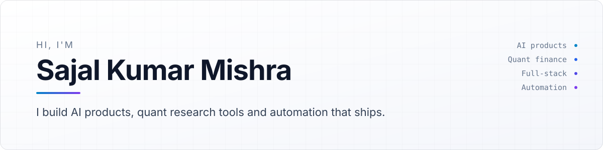

<picture>
  <source media="(prefers-color-scheme: dark)" srcset="./assets/header-dark.svg" />
  <source media="(prefers-color-scheme: light)" srcset="./assets/header-light.svg" />
  
</picture>

  
  
  

Engineer from India working across three areas: **AI products**, **quantitative finance tooling**, and **automation**. I care about shipping working software with real users, not demos.

## Now building — [Nomadic](https://nomadicai.vercel.app)

A desktop app that takes Indian engineering students from learning to hired:

- **Learn** — role-based roadmap, spaced-repetition reviews, daily queue
- **Practice** — ~1,800 company interview problems, timed mocks, AI feedback
- **Job board** — openings matched to your skills, with the gaps you need to close
- **Apply with review** — fills real application forms, submits only after you check every field
- **Track** — every application in one kanban, synced to your account

`Electron` · `React` · `TypeScript` · `Supabase` · `Playwright` · monorepo with its own design system, form engine and job-scraping pipeline

## Selected work

**Quant & finance**

| Project | What it does | Stack |
| --- | --- | --- |
| [RSEW (Regime Shift Early Warning)](https://github.com/snipy09/RSEW) | Flags market regime shifts early using rolling SVD + Hidden Markov Models, evaluated against real drawdowns | Python · hmmlearn · Streamlit |
| [monte-carlo-portfolio-optimizer](https://github.com/snipy09/Monte-carlo-simulation-for-portfolio-optimization) | 10k+ vectorised simulations + Markowitz (SLSQP) on Ledoit-Wolf covariance; Sharpe, Sortino, VaR, CVaR — [live](https://mcs-portfolio-optimizer.vercel.app) | Python · NumPy · SciPy · Plotly |
| [OHLCV Pipeline](https://github.com/snipy09/OHLCV) | Fetches, validates, cleans and quality-scores market data; handles splits and dividends; CSV + SQLite out | Python · pandas · SQLite |

**AI & web products**

| Project | What it does | Stack |
| --- | --- | --- |
| [subreddit-vibe-check](https://github.com/snipy09/subreddit-vibe-check) | Sentiment and "vibe" analytics for any subreddit's top 50 posts — [live](https://subreddit-vibe-check-pi.vercel.app) | Next.js · TypeScript |
| [ads-insights-dashboard](https://github.com/snipy09/Meta-google-ads-integrated-dashboard) | Meta Ads + Google Ads in one dashboard with Claude-generated performance insights | Next.js · Claude API · Recharts |
| [pulseflow-website](https://github.com/snipy09/As1) | Statically exported B2B SaaS marketing site — [live](https://as1-two.vercel.app) | Next.js 15 · Framer Motion |
| [dental-clinic-website](https://github.com/snipy09/dentist-clinic-website) | Conversion-focused website for a real dental clinic | React · Vite |

**Automation**

| Project | What it does | Stack |
| --- | --- | --- |
| [telegram-job-bot](https://github.com/snipy09/telegram-job-bot) | Aggregates remote/tech jobs from 4 sources, keyword alerts, bookmarks; Docker + GCP deploy | Python · Docker |
| [github-achievements](https://github.com/snipy09/github-achievements) | Automated verification engine and badge tracker for GitHub profile achievements with category statistics | Python · CLI |
| [flashjob-marketing-bot](https://github.com/snipy09/flashjob-marketing-bot) | Generates and schedules community posts across Reddit, X and Discord | Python · Playwright |
| [instagram-automation](https://github.com/snipy09/instagram-automation) | AI-written comments and DM replies with rate limits and a local dashboard | TypeScript · Playwright |

## Toolbox

  

Also: NumPy · pandas · SciPy · scikit-learn · Streamlit · Plotly · Playwright · Claude / OpenAI APIs

## Community

Contributor with [GitHub Community GITAM](https://github.com/github-community-gitam) — workshops, hackathons (EPOCH) and starter labs on MCP and agentic RAG.

---

Open to internships, freelance builds and collaborations — email is the fastest way to reach me.
